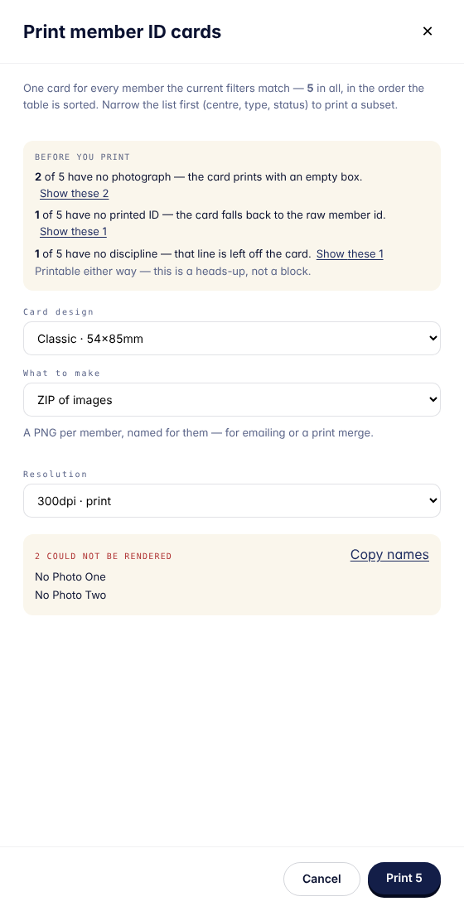

# Importing the roster from the members workbook

NGG's roster lived in a Google Sheet for three intakes before it lived in this
database, and a centre lead still adds a child to that sheet on a Saturday. This
is the one-way door between the two.

```bash
node tools/ngg-import/extract.js ~/NGG_Members.xlsx   # workbook → roster file
```

It prints a **sha256** for the file it wrote. Keep it — the next section is why.

Then load it, whichever way you have:

| | |
|---|---|
| **No shell** (the usual case) | **Control Room → Members → Import roster**, choose the file, read the dry run, press Import. Nothing is written until you do. |
| **With a shell** | `php api/tools/seed-members.php` to read the dry run, then `--apply`. |

Two steps rather than one either way, because the workbook needs Node and the
database needs PHP, and shared hosts have PHP but rarely Node. Extract on a
laptop; load the file from the browser or from the server.


Reading what an import *would* do needs the **people** capability. Applying one
needs **super admin** — a roster file rewrites the membership table in a single
action, which is a different decision from editing one child's record.

---

## Before you run it

**The roster file holds children's personal data** — names, birthdays, home
addresses, schools and guardians' phone numbers. It is written to
`api/storage/seed/`, which `.gitignore` excludes. Do not commit it, do not put
it in a ticket, and delete it from the server once the import has run. The
database is where that data belongs; a JSON file on disk is a second copy
nobody is protecting.

**Nothing is written until you ask for it** — the Import button in the drawer,
`--apply` on the command line. The first pass reports every row it would create
or change. Read it. A roster import that goes wrong against live records is not
something you can quietly re-run your way out of.

---

## The two hashes

A roster file carries children's names, birthdays, home addresses and
guardians' phone numbers from a laptop to a shared host, usually by whatever
route is to hand. And an import rewrites the membership table in one action.
So two different things get hashed, answering two different questions.

| | `fileSha` | `digest` |
|---|---|---|
| **Question** | Is this the file the extractor made? | Is this the import I previewed? |
| **Over** | The raw bytes on disk | What the roster would *do* |
| **Made by** | `extract.js`, and the browser as it reads | The server, from the payload it received |
| **Changes when** | Anything in the file changes, including `extractedAt` | The outcome changes |

**`fileSha`** is a plain SHA-256 of the bytes. Re-extracting the same workbook
gives a different one, because the file records when it was made — which is the
point: it identifies a *file*, not a roster.

```bash
node tools/ngg-import/extract.js book.xlsx        # prints  sha256  e89c753d…
php api/tools/seed-members.php --expect-sha e89c753d…   # refuses if it differs
```

`--expect-sha` checks before the config loads and before the database is
opened, so a file that is not the one you meant stops the run rather than
half-completing it. Without the flag the hash is reported and not enforced,
because most runs are on a file that never moved. In the Control Room the
drawer shows the same number for the file it just read, so you can compare it
against your terminal.

**`digest`** is `members_import_digest()` — a hash of the *outcome*. It ignores
row order, key order and blank values, because none of those change what the
import does, and because the browser reparses and reposts the payload so byte
equality is not available server-side anyway.

It closes a real hole. Preview and apply are two separate posts, each carrying
its own copy of the payload, and the confirmation dialog quotes the dry run's
numbers back at you — so before this, picking a different file after reading
the preview wrote a roster nobody had confirmed. The dry run now returns the
digest, the apply sends it back, and the server recomputes it from what it
actually received:

```
preview  →  digest 4f2a…            "2 new, 1 updated"
apply    →  expectDigest 4f2a…      ✓ writes
apply    →  expectDigest (absent)   ✗ preview_required
apply    →  a different file        ✗ roster_changed — read the dry run again
```

Every applied run is recorded in `member_import_runs` with both hashes, who ran
it and what it did. That is also how the drawer can tell you *"this exact
roster was applied on the 3rd"* before you apply it again — a heads-up, not a
block, since re-running after fixing four rows in the sheet is the normal
workflow.

---

## What the extractor reads

Five of the workbook's twenty sheets carry roster facts. It fails loudly if one
has been renamed, rather than importing fewer people than you expected.

| Sheet | What it decides |
|---|---|
| `MEMBERS` | Every member ID ever issued, so it decides who exists at all |
| `NGGC MEMBERS` | The live registry — structured names, faculties, birthday, contact |
| `AYOBO NGG MEMBERS` | The Ayobo centre's copy of the same, plus that centre's own members |
| `Form responses 1` | The registration form — school, class, sex, address, guardians |
| `State of NGG` | The dated status snapshot, which outranks the registry |

Within the registry sheets, a row whose first cell reads `PASSIVE` divides the
current roster from everyone who has left.

## Where each fact lands

| Workbook | `members` column | Note |
|---|---|---|
| Members ID (`023-001`) | `displayId` | The printed ID. `memberId` is issued by the app |
| First\_Name + Last\_Name | `fullName` | |
| First\_Faculty | `track` | What the app calls a faculty elsewhere |
| First + Second\_Faculty | `disciplines` | The one or two shown on the ID card |
| Date\_Joined | `joinDate` | Excel serial → ISO date |
| Birthday | `dob` | |
| Email, Mobile\_Line | `email`, `phone` | Numbers that lost a leading zero to a numeric column get it back |
| Name of school | `school` | |
| Father's / Mother's name + number | `parentName`, `parentPhone` | Father first where both are on file; both are kept in the notes |
| Level (A, B, C, O) | `level` | Its own column since schema 109 |
| ID prefix (`023-`) | `cohort` | The intake year |
| Sheet the member came from | `centre` | Ayobo for that sheet's own members, Egbeda otherwise |
| `State of NGG` | `status` | See below |

`members` has no column for a child's **sex, class, local government, home
address or second guardian**. Rather than drop them, the importer writes them
into `notes` inside a fenced block:

```
[roster-import]
Imported from the members workbook on 2026-08-26.
Level B · Male · SS 3 · Alimosho LGA
Home: 8, Anuoluwapo street, Shasha, Lagos State.
Guardians: Father Eleyinmi Tosiah 07030098873; Mother Eleyinmi Adekunbi 08160774973
Recorded state: Upgraded to NGV
From sheets: NGGC MEMBERS, MEMBERS, Form responses 1, State of NGG
[/roster-import]
```

Anything you type above or below the fence survives a re-import; the block
itself is replaced.

Level used to live in there too. It has had its own column since **schema
109**, which also backfills it from that note — so a site seeded before the
column existed gets its levels the first time it serves a request after the
deploy, rather than waiting for somebody to re-run the import. The remaining
fields are a holding pattern, not a design: if class or LGA earn columns later,
this importer is the place to change.

### Statuses

| Snapshot says | Stored as |
|---|---|
| Active | `active` |
| Suspended | `suspended` |
| Breached Contract | `inactive` |
| Upgraded to NGV | `graduated-vanguard` |

A member the snapshot does not mention takes their status from which side of the
`PASSIVE` divider they are on. A word the table does not cover is reported and
the member left as the registry had them — never silently mapped.

---

## Re-running it

Safe, and expected. Members are matched on their printed ID first, so a second
run updates the same people rather than issuing them second member IDs. Fix four
rows in the sheet, re-extract, re-run: four updates.

Three things make that safe to do on a live site:

- **The Control Room outranks the spreadsheet.** An existing value is never
  replaced. Only blanks are filled. Pass `--overwrite` when you have decided the
  sheet is the better record.
- **A staff member is not a spreadsheet row.** Where someone has since been
  given a role, their status, name and email are left alone. Their profile can
  still be filled in.
- **It tells you it has seen this roster before.** An identical file is
  recognised by its `digest` and reported — on the command line and in the
  drawer — before the apply, not after.

| Flag | |
|---|---|
| `--file PATH` | Roster file (default `api/storage/seed/ngg-members.json`) |
| `--expect-sha H` | The sha256 `extract.js` printed. Refuses to run if the file on disk differs — check it when the file has travelled |
| `--apply` | Write the changes instead of describing them |
| `--overwrite` | Replace values a member already has |
| `--emit-events` | Fan `member.created`/`updated` out to the outbox and integrations. Off by default — a backfill of the whole roster is not news every subscriber needs at once |
| `--verbose` | List every row, not only the ones that change |

Exit code is non-zero if any row could not be used, so a cron or a CI step
notices. Every write is in `audit_log` under `member.import.create`,
`member.import.update` and `member.import.run`.

---

## How the file reaches the server — and the 406

The drawer sends the roster as a **file upload**, not inside the JSON request
body. That is not a detail: it is the difference between an import that works on
this host and one that does not.

A 136-member roster is about **110KB** as a JSON body — roughly 820 bytes a row,
because each row carries a home address and two guardians — and the importer's
own ceiling is 2000 rows, about 1.6MB. mod_security, which is on by default on
cPanel hosts, will inspect a request body up to `SecRequestBodyNoFilesLimit`
bytes and **reject** anything longer. That limit is **131072 bytes**, and on
cPanel the rejection is answered as **`406 Not Acceptable`**.

So the roster spent its whole life a few kilobytes under a wall it was always
going to hit, and the request was refused *in front of PHP*: nothing reached the
application, nothing was logged by it, and the only thing the drawer could
report about it was `http_406`.

The limit applies to bodies with **no upload in them**. A multipart file part is
bounded by `SecRequestBodyLimit` instead (13MB by default) and is not folded
into the request arguments the rule set inspects — which also means a child's
home address is no longer read as a possible injection attempt. So the bytes
now travel as a file part, exactly as they sat on disk.

Three things follow from that, all of them improvements on their own:

- **The server hashes what it received.** `fileSha` used to be the browser's
  claim about bytes the server never saw, and was absent altogether on plain
  http where `crypto.subtle` does not exist. It is now computed from the
  uploaded bytes, so the number recorded in `member_import_runs` is an answer
  rather than a report.
- **The file names its own workbook.** `source` is read from inside the roster
  file, falling back to the filename the browser had — so a run recorded as
  `download (3).json` becomes one recorded as `NGG_Members.xlsx`.
- **The dry run still binds the apply.** The digest is computed from the rows,
  not the bytes, and both posts send the same file, so `expectDigest` works
  exactly as before. Nothing about the safety property changed.

The JSON body is still accepted by the endpoint, and the drawer falls back to it
if the upload is refused — on a host with `file_uploads` off, or one that objects
to multipart rather than to size.

**If it is still refused,** the drawer now says so in words instead of showing a
status code: which HTTP status refused it, that a firewall and not the importer
is refusing, and the two ways past it. In order:

1. Ask the host to allow POSTs to `/api/admin/members.php` — on cPanel this is
   *Security → ModSecurity*, disabled per-domain or per-rule.
2. Import from a shell instead: `php api/tools/seed-members.php --file <roster>`.
   This is the reason `--expect-sha` exists — the file has travelled.

---

## What it will not do for you

The extractor reports rather than guesses, so expect a list of things a human
has to settle. From the August 2026 workbook, the ones that recur:

- **One member ID against two different children.** Reported; the second child
  is not imported until they have an ID of their own.
- **One child against two member IDs.** Both are imported — dropping one loses a
  child — and flagged for a manual merge.
- **Siblings sharing a parent's email address.** Both members are created, but
  only one of them can ever sign in with it.
- **A registration matching nobody on the roster.** Usually a sibling who never
  enrolled. No member is created for them.
- **A name spelled two ways.** Merged only when a birthday or an email agrees;
  a near match is always reported so someone can confirm it. A sibling whose
  birthday disagrees never inherits the other one's school and address.

## After the import: nobody has a headshot

The workbook's `Image` column is empty for every member, so every imported
record has a blank `photoUrl`. The card handles that now, and the print drawer
says so before a run.

**The card composes either way.** The photo area used to be sized at 1.12 × the
card's own width — taller than any portrait — so a card with no headshot pushed
itself past its own trim: 13.2mm over on A5 (eating the 12mm bottom margin and
putting the QR in the trim) and 11.1mm over on the wallet size (no margin to
absorb it, so the footer row was cut in half). The photo box is now a fixed
height per size — 102.3mm on A5, 37.8mm on the wallet — bled symmetrically to
the card edges. Content height is exactly the card height in all three cases:
with a portrait, with a square crop, and with nothing.


**The print drawer counts the gaps first.** Control Room → Members → Print IDs
reads the filtered roster when it opens rather than when Print is pressed, so
the button carries the real number and the selection can be checked before any
paper is committed:



It counts three things, each of which prints perfectly well and is wrong in the
hand: no photograph (empty box), no printed ID (the card falls back to the raw
member id), no discipline (that line is left off). It is a heads-up, not a
block — an ID with an empty photo box is still an ID, and a cohort whose
photographs are still being collected still needs cards.

**Each count is a link to those members.** The roster grew a *rows with
something missing* filter for it (`missing=photo|printedId|discipline`), because
a number nobody can act on is an accusation rather than a tool — before it,
nothing in the product could turn "90 have no photograph" into those ninety.
The client-side counts and the server-side predicates are the same rule written
twice, so `api/tests/run.php` re-derives each expected set in PHP and demands
the server return exactly it; a count that led to a page showing a different
number would be worse than no link.

Anything the renderer could not draw is listed in the drawer, stays there, and
can be lifted out with **Copy names**. It used to be a toast truncated to three
names, which left a run with eleven gaps with nobody able to say which eleven.

Collecting the photographs is still the right end state — the card is designed
around one, the guardian retake link already exists, and a member ID with no
face on it is weak identification. It is no longer a blocker on printing.

## Tests

```bash
npm run test:roster      # the extractor: which sheet wins, and what it refuses
npm run test:rosterui    # the drawer: you cannot apply what you have not read
npm run test:rostersend  # the transport: the file goes as a file, and the 406 fallback
npm run test:api         # the import: idempotency, staff guards, notes fencing
npm run test:idbatch     # the print drawer: the preflight counts, and the run order
npm run shot:memberid    # re-render docs/screens/26-nggc-member-id.png
```
