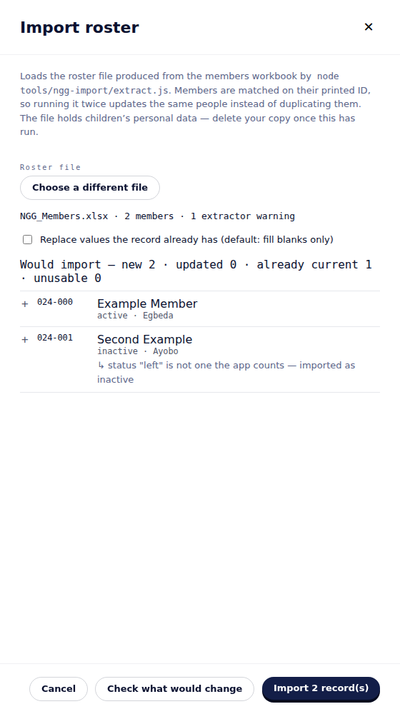

# Importing the roster from the members workbook

NGG's roster lived in a Google Sheet for three intakes before it lived in this
database, and a centre lead still adds a child to that sheet on a Saturday. This
is the one-way door between the two.

```bash
node tools/ngg-import/extract.js ~/NGG_Members.xlsx   # workbook → roster file
```

Then load it, whichever way you have:

| | |
|---|---|
| **No shell** (the usual case) | **Control Room → Members → Import roster**, choose the file, read the dry run, press Import. Nothing is written until you do. |
| **With a shell** | `php api/tools/seed-members.php` to read the dry run, then `--apply`. |

Two steps rather than one either way, because the workbook needs Node and the
database needs PHP, and shared hosts have PHP but rarely Node. Extract on a
laptop; load the file from the browser or from the server.



Reading what an import *would* do needs the **people** capability. Applying one
needs **super admin** — a roster file rewrites the membership table in a single
action, which is a different decision from editing one child's record.

---

## Before you run it

**The roster file holds children's personal data** — names, birthdays, home
addresses, schools and guardians' phone numbers. It is written to
`api/storage/seed/`, which `.gitignore` excludes. Do not commit it, do not put
it in a ticket, and delete it from the server once the import has run. The
database is where that data belongs; a JSON file on disk is a second copy
nobody is protecting.

**Nothing is written until you ask for it** — the Import button in the drawer,
`--apply` on the command line. The first pass reports every row it would create
or change. Read it. A roster import that goes wrong against live records is not
something you can quietly re-run your way out of.

---

## What the extractor reads

Five of the workbook's twenty sheets carry roster facts. It fails loudly if one
has been renamed, rather than importing fewer people than you expected.

| Sheet | What it decides |
|---|---|
| `MEMBERS` | Every member ID ever issued, so it decides who exists at all |
| `NGGC MEMBERS` | The live registry — structured names, faculties, birthday, contact |
| `AYOBO NGG MEMBERS` | The Ayobo centre's copy of the same, plus that centre's own members |
| `Form responses 1` | The registration form — school, class, sex, address, guardians |
| `State of NGG` | The dated status snapshot, which outranks the registry |

Within the registry sheets, a row whose first cell reads `PASSIVE` divides the
current roster from everyone who has left.

## Where each fact lands

| Workbook | `members` column | Note |
|---|---|---|
| Members ID (`023-001`) | `displayId` | The printed ID. `memberId` is issued by the app |
| First\_Name + Last\_Name | `fullName` | |
| First\_Faculty | `track` | What the app calls a faculty elsewhere |
| First + Second\_Faculty | `disciplines` | The one or two shown on the ID card |
| Date\_Joined | `joinDate` | Excel serial → ISO date |
| Birthday | `dob` | |
| Email, Mobile\_Line | `email`, `phone` | Numbers that lost a leading zero to a numeric column get it back |
| Name of school | `school` | |
| Father's / Mother's name + number | `parentName`, `parentPhone` | Father first where both are on file; both are kept in the notes |
| Level (A, B, C, O) | `level` | Its own column since schema 109 |
| ID prefix (`023-`) | `cohort` | The intake year |
| Sheet the member came from | `centre` | Ayobo for that sheet's own members, Egbeda otherwise |
| `State of NGG` | `status` | See below |

`members` has no column for a child's **sex, class, local government, home
address or second guardian**. Rather than drop them, the importer writes them
into `notes` inside a fenced block:

```
[roster-import]
Imported from the members workbook on 2026-08-26.
Level B · Male · SS 3 · Alimosho LGA
Home: 8, Anuoluwapo street, Shasha, Lagos State.
Guardians: Father Eleyinmi Tosiah 07030098873; Mother Eleyinmi Adekunbi 08160774973
Recorded state: Upgraded to NGV
From sheets: NGGC MEMBERS, MEMBERS, Form responses 1, State of NGG
[/roster-import]
```

Anything you type above or below the fence survives a re-import; the block
itself is replaced.

Level used to live in there too. It has had its own column since **schema
109**, which also backfills it from that note — so a site seeded before the
column existed gets its levels the first time it serves a request after the
deploy, rather than waiting for somebody to re-run the import. The remaining
fields are a holding pattern, not a design: if class or LGA earn columns later,
this importer is the place to change.

### Statuses

| Snapshot says | Stored as |
|---|---|
| Active | `active` |
| Suspended | `suspended` |
| Breached Contract | `inactive` |
| Upgraded to NGV | `graduated-vanguard` |

A member the snapshot does not mention takes their status from which side of the
`PASSIVE` divider they are on. A word the table does not cover is reported and
the member left as the registry had them — never silently mapped.

---

## Re-running it

Safe, and expected. Members are matched on their printed ID first, so a second
run updates the same people rather than issuing them second member IDs. Fix four
rows in the sheet, re-extract, re-run: four updates.

Two rules make that safe to do on a live site:

- **The Control Room outranks the spreadsheet.** An existing value is never
  replaced. Only blanks are filled. Pass `--overwrite` when you have decided the
  sheet is the better record.
- **A staff member is not a spreadsheet row.** Where someone has since been
  given a role, their status, name and email are left alone. Their profile can
  still be filled in.

| Flag | |
|---|---|
| `--file PATH` | Roster file (default `api/storage/seed/ngg-members.json`) |
| `--apply` | Write the changes instead of describing them |
| `--overwrite` | Replace values a member already has |
| `--emit-events` | Fan `member.created`/`updated` out to the outbox and integrations. Off by default — a backfill of the whole roster is not news every subscriber needs at once |
| `--verbose` | List every row, not only the ones that change |

Exit code is non-zero if any row could not be used, so a cron or a CI step
notices. Every write is in `audit_log` under `member.import.create`,
`member.import.update` and `member.import.run`.

---

## What it will not do for you

The extractor reports rather than guesses, so expect a list of things a human
has to settle. From the August 2026 workbook, the ones that recur:

- **One member ID against two different children.** Reported; the second child
  is not imported until they have an ID of their own.
- **One child against two member IDs.** Both are imported — dropping one loses a
  child — and flagged for a manual merge.
- **Siblings sharing a parent's email address.** Both members are created, but
  only one of them can ever sign in with it.
- **A registration matching nobody on the roster.** Usually a sibling who never
  enrolled. No member is created for them.
- **A name spelled two ways.** Merged only when a birthday or an email agrees;
  a near match is always reported so someone can confirm it. A sibling whose
  birthday disagrees never inherits the other one's school and address.

## After the import: nobody has a headshot

The workbook's `Image` column is empty for every member, so every imported
record has a blank `photoUrl`. That matters for the printed ID, because
`NggcMemberCard` sizes its empty photo box at 1.12 × its own width — taller than
any portrait — and the card then overflows its own physical height:

| Card | Content height | Card height | Overrun |
|---|---|---|---|
| A5, no headshot | 223.2mm | 148×210mm | **13.2mm** — eats the 12mm bottom margin, putting the QR in the trim |
| Wallet, no headshot | 96.1mm | 54×85mm | **11.1mm** — no margin to absorb it, so the footer row is cut in half |
| Either size, with a headshot | exactly the card | | none |


So the cards are printable as soon as the headshots are, and not before. Two
ways out, in the order they are worth trying:

1. **Collect the photographs.** The card is designed around one, the guardian
   retake link already exists, and a member ID with no face on it is weak
   identification anyway.
2. **Make the card compose without one** — give the photo area a fixed box
   rather than a width multiple, so the layout is the same with a portrait, with
   a square crop, or with nothing. That is a change to a spec'd print design
   (consultation REV 1 · Aug 2026), so it wants a decision, not a patch.

## Tests

```bash
npm run test:roster      # the extractor: which sheet wins, and what it refuses
npm run test:rosterui    # the drawer: you cannot apply what you have not read
npm run test:api         # the import: idempotency, staff guards, notes fencing
npm run shot:memberid    # re-render docs/screens/26-nggc-member-id.png
```
