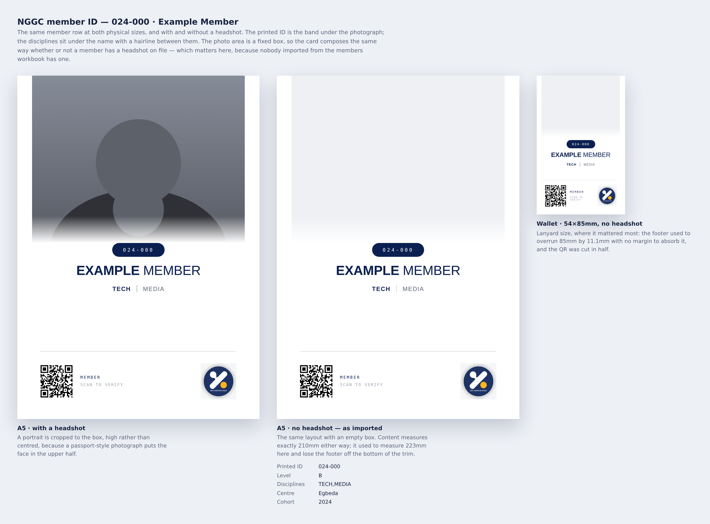

# Importing the roster from the members workbook

NGG's roster lived in a Google Sheet for three intakes before it lived in this
database, and a centre lead still adds a child to that sheet on a Saturday. This
is the one-way door between the two.

```bash
node tools/ngg-import/extract.js ~/NGG_Members.xlsx   # workbook → roster file
```

It prints a **sha256** for the file it wrote. Keep it — the next section is why.

Then load it, whichever way you have:

| | |
|---|---|
| **No shell** (the usual case) | **Control Room → Members → Import roster**, choose the file, read the dry run, press Import. Nothing is written until you do. |
| **With a shell** | `php api/tools/seed-members.php` to read the dry run, then `--apply`. |

Two steps rather than one either way, because the workbook needs Node and the
database needs PHP, and shared hosts have PHP but rarely Node. Extract on a
laptop; load the file from the browser or from the server.


Reading what an import *would* do needs the **people** capability. Applying one
needs **super admin** — a roster file rewrites the membership table in a single
action, which is a different decision from editing one child's record.

---

## Before you run it

**The roster file holds children's personal data** — names, birthdays, home
addresses, schools and guardians' phone numbers. It is written to
`api/storage/seed/`, which `.gitignore` excludes. Do not commit it, do not put
it in a ticket, and delete it from the server once the import has run. The
database is where that data belongs; a JSON file on disk is a second copy
nobody is protecting.

**Nothing is written until you ask for it** — the Import button in the drawer,
`--apply` on the command line. The first pass reports every row it would create
or change. Read it. A roster import that goes wrong against live records is not
something you can quietly re-run your way out of.

---

## The two hashes

A roster file carries children's names, birthdays, home addresses and
guardians' phone numbers from a laptop to a shared host, usually by whatever
route is to hand. And an import rewrites the membership table in one action.
So two different things get hashed, answering two different questions.

| | `fileSha` | `digest` |
|---|---|---|
| **Question** | Is this the file the extractor made? | Is this the import I previewed? |
| **Over** | The raw bytes on disk | What the roster would *do* |
| **Made by** | `extract.js`, and the browser as it reads | The server, from the payload it received |
| **Changes when** | Anything in the file changes, including `extractedAt` | The outcome changes |

**`fileSha`** is a plain SHA-256 of the bytes. Re-extracting the same workbook
gives a different one, because the file records when it was made — which is the
point: it identifies a *file*, not a roster.

```bash
node tools/ngg-import/extract.js book.xlsx        # prints  sha256  e89c753d…
php api/tools/seed-members.php --expect-sha e89c753d…   # refuses if it differs
```

`--expect-sha` checks before the config loads and before the database is
opened, so a file that is not the one you meant stops the run rather than
half-completing it. Without the flag the hash is reported and not enforced,
because most runs are on a file that never moved. In the Control Room the
drawer shows the same number for the file it just read, so you can compare it
against your terminal.

**`digest`** is `members_import_digest()` — a hash of the *outcome*. It ignores
row order, key order and blank values, because none of those change what the
import does, and because the browser reparses and reposts the payload so byte
equality is not available server-side anyway.

It closes a real hole. Preview and apply are two separate posts, each carrying
its own copy of the payload, and the confirmation dialog quotes the dry run's
numbers back at you — so before this, picking a different file after reading
the preview wrote a roster nobody had confirmed. The dry run now returns the
digest, the apply sends it back, and the server recomputes it from what it
actually received:

```
preview  →  digest 4f2a…            "2 new, 1 updated"
apply    →  expectDigest 4f2a…      ✓ writes
apply    →  expectDigest (absent)   ✗ preview_required
apply    →  a different file        ✗ roster_changed — read the dry run again
```

Every applied run is recorded in `member_import_runs` with both hashes, who ran
it and what it did. That is also how the drawer can tell you *"this exact
roster was applied on the 3rd"* before you apply it again — a heads-up, not a
block, since re-running after fixing four rows in the sheet is the normal
workflow.

---

## What the extractor reads

Five of the workbook's twenty sheets carry roster facts. It fails loudly if one
has been renamed, rather than importing fewer people than you expected.

| Sheet | What it decides |
|---|---|
| `MEMBERS` | Every member ID ever issued, so it decides who exists at all |
| `NGGC MEMBERS` | The live registry — structured names, faculties, birthday, contact |
| `AYOBO NGG MEMBERS` | The Ayobo centre's copy of the same, plus that centre's own members |
| `Form responses 1` | The registration form — school, class, sex, address, guardians |
| `State of NGG` | The dated status snapshot, which outranks the registry |

Within the registry sheets, a row whose first cell reads `PASSIVE` divides the
current roster from everyone who has left.

## Where each fact lands

| Workbook | `members` column | Note |
|---|---|---|
| Members ID (`023-001`) | `displayId` | The printed ID. `memberId` is issued by the app. **Leave it blank and the app issues one** (`YYY-NNN`, above the highest serial for that year *and* above every ID in the file) — the dry run names the ID each new member will get, so you can write them back. A registry member with no ID anywhere is imported without one and numbered, rather than dropped. Older ID shapes (`NGG/23/042`) are kept as printed; see *Member IDs and their formats*. |
| First\_Name + Last\_Name | `fullName` | |
| First\_Faculty | `track` | What the app calls a faculty elsewhere |
| First + Second\_Faculty | `disciplines` | The one or two shown on the ID card |
| Date\_Joined | `joinDate` | Stored as an ISO date. Read from a date cell (Excel serial) or from text typed day first — `15/03/2023`, `15-3-23`, `15 March 2023`, `Mar 2023` (the 1st), `2023` (1 January). The header may be spelled `Date_Joined`, `Date Joined`, `Joined` or `Join Date`; the `MEMBERS` sheet's own join date column is read too, for members on no registry sheet. A value that is not a date (or is month first, `03/15/2023`) is left blank and named in the dry run, never stored as written. Re-running the import fills a join date that is blank on the record. |
| Birthday | `dob` | |
| Email, Mobile\_Line | `email`, `phone` | Numbers that lost a leading zero to a numeric column get it back |
| Name of school | `school` | |
| Father's / Mother's name + number | `parentName`, `parentPhone` | Father first where both are on file; both are kept in the notes |
| Level (A, B, C, O) | `level` | Its own column since schema 109 |
| ID prefix (`023-`) | `cohort` | The **intake year** — not a Summer School edition, which is what "cohort" means everywhere else in this product. Left blank, the app issues an ID from the join year. |
| Sheet the member came from | `centre` | Ayobo for that sheet's own members, Egbeda otherwise |
| `State of NGG` | `status` | See below |

`members` has no column for a child's **sex, class, local government, home
address or second guardian**. Rather than drop them, the importer writes them
into `notes` inside a fenced block:

```
[roster-import]
Imported from the members workbook on 2026-08-26.
Level B · Male · SS 3 · Alimosho LGA
Home: 8, Anuoluwapo street, Shasha, Lagos State.
Guardians: Father Eleyinmi Tosiah 07030098873; Mother Eleyinmi Adekunbi 08160774973
Recorded state: Upgraded to NGV
From sheets: NGGC MEMBERS, MEMBERS, Form responses 1, State of NGG
[/roster-import]
```

Anything you type above or below the fence survives a re-import; the block
itself is replaced.

Level used to live in there too. It has had its own column since **schema
109**, which also backfills it from that note — so a site seeded before the
column existed gets its levels the first time it serves a request after the
deploy, rather than waiting for somebody to re-run the import. The remaining
fields are a holding pattern, not a design: if class or LGA earn columns later,
this importer is the place to change.

### Statuses

| Snapshot says | Stored as |
|---|---|
| Active | `active` |
| Suspended | `suspended` |
| Breached Contract | `inactive` |
| Upgraded to NGV | `graduated-vanguard` |

A member the snapshot does not mention takes their status from which side of the
`PASSIVE` divider they are on. A word the table does not cover is reported and
the member left as the registry had them — never silently mapped.

---

## Re-running it

Safe, and expected. Members are matched on their printed ID first, so a second
run updates the same people rather than issuing them second member IDs. Fix four
rows in the sheet, re-extract, re-run: four updates.

Three things make that safe to do on a live site:

- **The Control Room outranks the spreadsheet.** An existing value is never
  replaced. Only blanks are filled. Pass `--overwrite` when you have decided the
  sheet is the better record.
- **A staff member is not a spreadsheet row.** Where someone has since been
  given a role, their status, name and email are left alone. Their profile can
  still be filled in.
- **It tells you it has seen this roster before.** An identical file is
  recognised by its `digest` and reported — on the command line and in the
  drawer — before the apply, not after.

| Flag | |
|---|---|
| `--file PATH` | Roster file (default `api/storage/seed/ngg-members.json`) |
| `--expect-sha H` | The sha256 `extract.js` printed. Refuses to run if the file on disk differs — check it when the file has travelled |
| `--apply` | Write the changes instead of describing them |
| `--overwrite` | Replace values a member already has |
| `--emit-events` | Fan `member.created`/`updated` out to the outbox and integrations. Off by default — a backfill of the whole roster is not news every subscriber needs at once |
| `--verbose` | List every row, not only the ones that change |

Exit code is non-zero if any row could not be used, so a cron or a CI step
notices. Every write is in `audit_log` under `member.import.create`,
`member.import.update` and `member.import.run`.

---

## How the file reaches the server — and the 406

The drawer sends the roster as **one value**: `rosterJson`, the text of the file
exactly as `extract.js` wrote it. Not as an array of member objects, and not as
a file upload. That is not a detail — it is the difference between an import
that works on this host and one that does not.

The import was being refused with **`406 Not Acceptable`**. Nothing in this
application sends a 406 (grep for it), so the request was being rejected in
front of PHP, by the host's mod_security. What it objects to was **measured**
against the live site rather than guessed, using unauthenticated posts — PHP
answers those at the CSRF gate, so a reply of `csrf_failed` means the request
got through:

| Request to `/api/admin/members.php` | |
|---|---|
| 6.5KB of roster JSON, ~90 values | reached PHP |
| 55KB of roster JSON, **3201 values** | **406** |
| 322KB in 161 values | reached PHP |
| 131KB in 2 values | reached PHP |
| multipart, **any file part**, even ~200 bytes | **406** |
| multipart, form fields only | reached PHP |
| whole roster as **one** string value, 172KB and 736KB | reached PHP |
| the same, 2.45MB | 413 — a real body limit |

So it counts the **number of values** in a JSON body and refuses a request
carrying a few thousand of them. **Size is not the problem**: 322KB in 161
values goes through where 55KB in 3201 values does not. A 136-member roster
posted as an array of objects is around 3000 values, so it was always going to
hit that wall, and it hit it as the roster grew — with nothing in this codebase
changing. All the drawer could report about a request the application never
received was `http_406`.

File uploads are refused outright on the same host, so sending the roster as an
upload — the obvious fix, and the first one tried — does not work either.

Sending the file as a single string does. It is also the honest shape, and it
hands the server the file instead of the browser's summary of it:

- **The server hashes what it received.** `fileSha` was the browser's claim
  about a file the server never saw, and was absent altogether on plain http
  where `crypto.subtle` does not exist. It is hashed from the received text now,
  which for the UTF-8 the extractor writes is the file's own sha256 — the number
  `extract.js` prints. (A file saved with a byte-order mark would differ by
  those three bytes; the extractor never writes one.)
- **The file names its own workbook.** `source` is read from inside the roster
  file, falling back to the filename the browser had — so a run recorded as
  `download (3).json` becomes one recorded as `NGG_Members.xlsx`.
- **The dry run still binds the apply.** The digest is computed over the parsed
  rows, and both posts send the same text, so `expectDigest` works exactly as
  before. Nothing about the safety property changed.

The older shape — `members` as an array of objects — is still accepted by the
endpoint, and the drawer falls back to it if the one-value post is refused by
something that is not this application. Measured headroom on this host is
comfortable: 736KB of roster text went through, which is around 600 members. At
2.45MB the host answers 413, which is a limit on the request rather than a rule
about it; the importer's own 2000-row ceiling is past what this transport
carries, and 2000 rows was never this roster.

**If it is still refused,** the drawer now says so in words instead of showing a
status code: which HTTP status refused it, that a firewall and not the importer
is refusing, and the two ways past it. In order:

1. Ask the host to allow POSTs to `/api/admin/members.php` — on cPanel this is
   *Security → ModSecurity*, disabled per-domain or per-rule. Worth doing
   anyway: the same rule will refuse the next bulk write the product grows.
2. Import from a shell instead: `php api/tools/seed-members.php --file <roster>`.
   This is the reason `--expect-sha` exists — the file has travelled.

---

## What it will not do for you

The extractor reports rather than guesses, so expect a list of things a human
has to settle. From the August 2026 workbook, the ones that recur:

- **One member ID against two different children.** Reported; the second child
  is not imported until they have an ID of their own.
- **One child against two member IDs.** Both are imported — dropping one loses a
  child — and flagged for a manual merge.
- **Siblings sharing a parent's email address.** Both members are created, but
  only one of them can ever sign in with it.
- **A registration matching nobody on the roster.** Usually a sibling who never
  enrolled. No member is created for them.
- **A name spelled two ways.** Merged only when a birthday or an email agrees;
  a near match is always reported so someone can confirm it. A sibling whose
  birthday disagrees never inherits the other one's school and address.

## Cards: every imported member can be checked in at the gate

An imported member used to arrive with **no card the CACENTRE gate could read**,
so at the door they could only be found by name. Now the import gives every NGG
member it touches — created, updated or already current — two things:

- **A secure card** (`MEMQR-` and sixteen random characters), if they have none.
  It is what new cards are printed with, it cannot be guessed, and reissuing it
  voids the old one at once. Members created in the Control Room, through an
  application or by promotion out of the Club get one too.
- **The card already in their wallet, recorded.** Those cards were printed before
  this system and carry whatever the old process put on them. The drawer asks
  *"Cards these members already hold"*: by default the member number printed on
  them (`023-001`). If the old cards read differently — a URL, an old code — pick
  **Describe another kind of card…**, paste what one scans as and point at the
  number in it. The format is worked out for you (`{any}/member/{id}`, number
  shaped `999-999`), you can try a real card against it before saving, and the
  gate picks it up within a quarter of an hour. A roster column `cardCode` carries
  a code that matches no field.

An old printed card is weaker than a secure one — a member number is not a
secret — so the desk says *old printed card* when it reads one. Reprinting a
member moves them onto their secure card; **Reprinted — retire the old card** on
their record stops the old one.

Members already on the roll before cards existed: **Members → Issue cards** gives
everybody with no card a secure one and records the number on the card they hold.
From a shell, `seed-members.php --card-format ID` names the format (`''` records
none).

## After the import: nobody has a headshot

The workbook's `Image` column is empty for every member, so every imported
record has a blank `photoUrl`. The card handles that now, and the print drawer
says so before a run.

**The card composes either way.** The photo area used to be sized at 1.12 × the
card's own width — taller than any portrait — so a card with no headshot pushed
itself past its own trim: 13.2mm over on A5 (eating the 12mm bottom margin and
putting the QR in the trim) and 11.1mm over on the wallet size (no margin to
absorb it, so the footer row was cut in half). The photo box is now a fixed
height per size — 102.3mm on A5, 37.8mm on the wallet — bled symmetrically to
the card edges. Content height is exactly the card height in all three cases:
with a portrait, with a square crop, and with nothing.



**The print drawer counts the gaps first.** Control Room → Members → Print IDs
reads the filtered roster when it opens rather than when Print is pressed, so
the button carries the real number and the selection can be checked before any
paper is committed:


It counts three things, each of which prints perfectly well and is wrong in the
hand: no photograph (empty box), no printed ID (the card falls back to the raw
member id), no discipline (that line is left off). It is a heads-up, not a
block — an ID with an empty photo box is still an ID, and a cohort whose
photographs are still being collected still needs cards.

**Each count is a link to those members.** The roster grew a *rows with
something missing* filter for it (`missing=photo|printedId|discipline`), because
a number nobody can act on is an accusation rather than a tool — before it,
nothing in the product could turn "90 have no photograph" into those ninety.
The client-side counts and the server-side predicates are the same rule written
twice, so `api/tests/run.php` re-derives each expected set in PHP and demands
the server return exactly it; a count that led to a page showing a different
number would be worse than no link.

Anything the renderer could not draw is listed in the drawer, stays there, and
can be lifted out with **Copy names**. It used to be a toast truncated to three
names, which left a run with eleven gaps with nobody able to say which eleven.

Collecting the photographs is still the right end state — the card is designed
around one, the guardian retake link already exists, and a member ID with no
face on it is weak identification. It is no longer a blocker on printing.

## Tests

```bash
npm run test:roster      # the extractor: which sheet wins, and what it refuses
npm run test:rosterui    # the drawer: you cannot apply what you have not read
npm run test:rostersend  # the transport: the file goes as a file, and the 406 fallback
npm run test:api         # the import: idempotency, staff guards, notes fencing
npm run test:idbatch     # the print drawer: the preflight counts, and the run order
npm run shot:memberid    # re-render docs/screens/26-nggc-member-id.png
```


---

## Member IDs and their formats

Every NGG member gets a printed ID, and no ID is two people. The importer
reads every ID in the file **before** writing anything, so:

- **A member with no ID is given one** — new members, *and* members already in
  the Control Room who have none (created on the desk, or imported before IDs
  were issued). The dry run says which ID each will get; the apply issues
  exactly those.
- **Issued IDs skip every ID the file carries.** A blank row is never given an
  ID that a later row of the same sheet already holds.
- **An ID on two rows** is refused on the second, naming the first.
- **An ID that belongs to someone else here** is refused, naming who holds it.
  The same person is recognised by name (in any word order), date of birth or
  email.
- **A printed ID is never changed by an import**, overwrite or not. If the sheet
  and the record disagree, the record's ID stands and the dry run says so.
- **A year that lost its zero** to a spreadsheet (`23-001`, `23/001`) is read as
  `023-001`, and the dry run says it was. The serial is kept as typed —
  `024-16` and `024-016` stay distinct, because the card says which.

### Declaring an older ID format

Today's shape is `YYY-NNN`. Cards printed earlier may carry another one. The
dry run lists every shape in the sheet that no format declares — `NGG/23/042`
is shape `AAA/99/999` — with **Declare this format**. Declaring (a super admin,
like any card format) does two things: the importer accepts those IDs as
printed, and the gate reads the cards that carry them, because their
QR is the ID.

**Refuse member IDs that fit no declared ID format** is on by default in the
drawer: an ID in an undeclared shape — usually a typo, `O24-016` with a letter
O — is refused rather than filed as an ID nobody can scan. Off, it imports with
a warning. Declaring a format changes what a dry run would do, so an apply must
follow a fresh dry run.

In a shape, `9` is a digit, `A` a letter, `X` either; everything else is as
printed. A literal `A` or `X` in an example therefore matches any letter there.

Give the **intake year** of the example when you declare it (`NGG/23/042` was
2023). The format then records where the year sits, and a member imported
with an ID in that shape and no intake year of their own is filed in the
year their ID says — the same as `023-001` already says 2023. A year that is
not in the example as varying digits is refused (`bad_year`).

### Typos

An ID in no declared shape is usually a slip: a letter O for a zero, an I or
L for a one, a missing dash. The dry run names what it probably is and whose
ID that is — `O24-016 looks like a typo for 024-016 (Adams Anthony)` — and a
strict import puts the same words in the refusal. It is a suggestion; the
sheet is corrected by whoever keeps it.

### One ID, one record — enforced by the database

`member_display_ids` (schema 122) has the printed ID as its primary key.
Every writer — the import, the desk, an application convert, a Club
promotion — **claims** an ID before writing it, so two writers racing for one
number cannot both win: the loser mints again, or, for an ID somebody typed,
is refused naming the holder. Claims are never released; a merge moves the
retired record's claim to the survivor, so the card from either record still
resolves to the person. Migration 122 claimed each existing ID for its
earliest record. Any later duplicates are on **Members → Duplicates →
Member IDs**, with the merge for a pair that is one person.

### Writing the IDs back to the workbook

The dry run and the result both offer **Download the ID list (CSV)**: every
row whose ID was issued here, or that the sheet spells differently from the
record (`19-950` for `019-950`, or no ID at all for somebody already
numbered). Copy the IDs into the workbook and the next import matches those
members on the ID rather than on their name. A name starting `=`, `+`, `-` or
`@` is written with a leading `'` so a spreadsheet shows it rather than
running it.

## Registrations with no roster row

A child on the registration form whom no roster row matches is **not**
dropped and **not** made a member. The extractor writes them to `applicants`
in the file, and the import files each as an application (anchor programme,
status new) for the desk to confirm in Applications. Confirming one is the
ordinary convert: it creates the member and issues their member ID. Each is
keyed (`importKey`), so the same file applied twice files them once, and one
already on the desk by name and birthday is counted as "already a member
here" instead. The applicants are part of what the dry run promised, so a
file whose applicants changed needs a fresh dry run.
